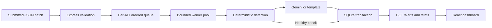

# Pulse — Intelligent API Monitoring & Alert System

A project that accepts API health measurements, detects anomalies with explicit rules, explains incidents using Gemini (with a reliable template fallback), persists them in SQLite, and displays them in a React dashboard.

## Start here (Windows / PowerShell)

Prerequisite: **Node.js 22.13 or newer**. This project uses Node's built-in SQLite module; Node 22 may print an experimental SQLite warning. There is no MongoDB server to install.

Open PowerShell in this project folder, then run:

```powershell
npm.cmd install
Copy-Item .env.example .env
npm.cmd run build
npm.cmd start
```

Open **http://127.0.0.1:3000**. Keep the terminal running. Stop it with **Ctrl+C**.

If `.env` already exists, keep it; do not copy over your key. On macOS/Linux, use `npm` instead of `npm.cmd` and `cp .env.example .env`. On Windows, `npm.cmd` avoids the PowerShell script execution-policy issue.

Click **Run sample checks**. You should see four monitored APIs and three incidents under the default threshold. Repeat the sample: incident occurrence counts increase instead of creating duplicates. Click **Submit checks → Load recovery → Process batch** to resolve the incidents. Switch to **Resolved** to see their history.

You can run without a Gemini key. Those alerts visibly say **Template explanation**; they are not represented as AI-generated. **Before submission, configure Gemini and verify at least one real AI explanation.**

## Enable Gemini

1. Obtain your API key in [Google AI Studio](https://aistudio.google.com/apikey).
2. Edit the local `.env` file: set `AI_MODE=gemini` and `GEMINI_API_KEY` to your key. Never put the key in frontend code or commit it. The default `AI_MODE=template` prevents external calls even if a key already exists in your shell environment.
3. Set `GEMINI_MODEL` to a text-generation model available to your account. The starter value is `gemini-3.8-flash`; model availability and quotas can change.
4. Restart the backend and run sample checks. Look for **AI explanation** on an incident.

The header's configured state only means a key exists. Each saved alert records whether generation actually succeeded. Provider errors, blocked/empty/truncated output, or timeouts generate a labelled template alert instead. No external AI call occurs for healthy results. API names and the three supplied metrics are sent to Gemini when enabled; don't include secrets in API names.

## What each technology does

- **Node.js** runs JavaScript outside the browser: our backend.
- **Express** routes incoming HTTP requests, for example `POST /monitor`, to our code.
- **SQLite** is a real SQL database stored as a local file, `data/pulse.sqlite`. It survives server restarts.
- **React** renders the dashboard and calls the backend.
- **Gemini** writes the explanation after our rules have identified the anomalies. It does not decide whether an API is unhealthy.
- **Vite** turns the React code into browser files in `dist/`; Express serves those files.

## Architecture



This is an **ingestion system**: callers send measurements. It does not poll remote endpoints, schedule checks, or measure response times itself. The dashboard examples are illustrative; the original assignment PDF was reviewed separately, and its PatientDataAPI/AppointmentAPI sample passed local verification (see [docs/VERIFICATION.md](./docs/VERIFICATION.md)).

```text
server/
  index.js                 Startup and graceful shutdown
  config.js                Validated environment configuration
  app.js                   HTTP routes, request logging, error handling
  services/detection.js    Pure validation and anomaly rules
  services/ai.js           Gemini request, prompt, and fallback
  services/scheduler.js    Shared bounded pool and API ordering
  services/monitor.js      Batch orchestration and partial results
  models/store.js          SQLite schema, transactions, queries
  utils/errors.js          HTTP error type
client/src/                React dashboard and responsive styles
tests/system.test.js       Detection, provider, persistence, concurrency, HTTP tests
examples/                 Sample incident and recovery batches
docs/                     Walkthrough and AI prompt log
scripts/                  Reproducible prompt-document generation
```

Routes remain in one short module; business logic and persistence are separate. Splitting trivial handlers into extra controller files was deliberately avoided.

## Detection and incident lifecycle

| Rule | Condition |
| --- | --- |
| `HIGH_RESPONSE_TIME` | `response_time_ms > SLOW_RESPONSE_MS` (default 3000; equality is healthy) |
| `FAILED_REQUEST` | `status_code >= 400` |
| `NO_DATA` | `records_returned` is zero, null, or omitted |

An observation can have all three anomalies. Severity is **critical** for HTTP 5xx; otherwise **high** for HTTP 4xx or multiple anomalies; otherwise **medium** for a single anomaly. Healthy observations have no severity and create no alert. Missing/zero records are treated as anomalies even on 204 responses, as requested in the assignment summary.

- API identity is the trimmed, case-sensitive `api_name`. Use a distinct stable name per endpoint/environment.
- At most one active incident per API, enforced by a unique partial database index. Further anomalous observations update its metrics, explanation, types, severity, and occurrence count.
- A healthy observation automatically resolves its active incident. The resolved record retains the last anomalous metrics; `api_states` retains the latest health measurements.
- Manual resolve acknowledges the incident; it does **not** change the latest measured health. A subsequent anomaly opens a new incident.
- Occurrences count anomalous observations, not distinct network requests. No client idempotency keys are implemented.
- Same-API results are processed in arrival order within the single server process. Timestamps are server processing times in UTC, shown in the browser's local timezone. Historical/out-of-order event timestamps are not supported.

## API reference

All endpoints are same-origin. JSON request bodies have a 1 MB limit. No authentication is included; the app binds to loopback by default for the local interview demo.

### `POST /monitor`

Header: `Content-Type: application/json`. Body: an array of 1–100 results by default.

```json
[
  {
    "api_name": "Payments API",
    "response_time_ms": 4820,
    "status_code": 503,
    "records_returned": 0
  }
]
```

Validation: name is a nonempty string of at most 120 characters with no control characters; response time is a finite number from 0 to 86,400,000; status is an integer from 100 to 599; records is a nonnegative safe integer, null, or omitted. Unknown fields are discarded. Numeric strings are rejected.

```powershell
Invoke-RestMethod -Uri http://127.0.0.1:3000/monitor -Method Post -ContentType 'application/json' -Body (Get-Content ./examples/sample.json -Raw)
```

```bash
curl -X POST http://127.0.0.1:3000/monitor -H "Content-Type: application/json" --data-binary @examples/sample.json
```

Response shape:

```json
{
  "summary": { "received": 1, "processed": 1, "invalid": 0, "failed": 0 },
  "results": [
    {
      "index": 0,
      "api_name": "Payments API",
      "status": "processed",
      "outcome": "created",
      "alert_id": "generated-uuid",
      "anomaly_types": ["HIGH_RESPONSE_TIME", "FAILED_REQUEST", "NO_DATA"],
      "message_source": "template"
    }
  ]
}
```

Outcomes: `created`, `updated`, `healthy`, `recovered`. Invalid and failed results contain an error and their zero-based input index. A healthy result without an existing incident has a null alert ID and message source.

HTTP **200** means all items were processed; **207** means one or more items were invalid or failed (including a fully invalid array). Always inspect `summary` and `results`. **400** is an invalid batch envelope or malformed JSON, **413** an oversized body, **415** a non-JSON content type, and **429** a full processing queue (`Retry-After: 5`). A 429 admits none of the batch; retry later. After 207 retry only failed entries to avoid inflating occurrence counts. Invalid entries should be corrected first.

### `GET /alerts`

Defaults to active incidents, newest update first. Response: `{ alerts, total, limit, offset }`.

| Parameter | Values / behavior |
| --- | --- |
| `status` | `active` (default), `resolved`, `all` |
| `severity` | `critical`, `high`, `medium`; omit for all |
| `api` | Case-insensitive substring search |
| `limit` | 1–100; default 20 |
| `offset` | Nonnegative integer; default 0 |

Example: `GET /alerts?status=active&severity=critical&limit=10&offset=0`.

Each alert includes ID, API name, anomaly types, severity, metrics, explanation (`message`), `message_source` (`gemini` or `template`), `fallback_reason`, status, occurrences, and creation/update/resolution timestamps.

### Other endpoints

- `PATCH /alerts/:id/resolve`: manually resolve an incident; no body required. Repeating this is safe. Unknown ID: 404.
- `GET /stats`: lifetime processed-check count, API count, healthy API count based on latest observations, active/critical/resolved incident counts.
- `GET /health`: process readiness and non-secret public configuration. `ai: configured` is not a provider connectivity test.

## Configuration

| Variable | Default | Purpose |
| --- | --- | --- |
| `HOST` | `127.0.0.1` | Local binding |
| `PORT` | `3000` | HTTP port |
| `DATABASE_PATH` | `./data/pulse.sqlite` | Persistent SQLite file |
| `SLOW_RESPONSE_MS` | `3000` | Slow response threshold |
| `MAX_BATCH_SIZE` | `100` | Maximum results per request |
| `WORKER_CONCURRENCY` | `4` | Shared maximum concurrent item workers |
| `MAX_PENDING_ITEMS` | `1000` | Shared limit of admitted unfinished items |
| `LLM_TIMEOUT_MS` | `30000` | Per-request provider timeout |
| `GEMINI_API_KEY` | Empty | Server-only provider key |
| `AI_MODE` | `template` | Set to `gemini` to enable external AI calls |
| `GEMINI_MODEL` | `gemini-3.8-flash` | Configurable provider model ID |
| `LOG_LEVEL` | `info` | Pino log level |

Logs are structured JSON on stdout with request IDs, response status, duration, batch counts, and fallback events. Provider bodies and keys are not logged. Responses to unexpected server errors hide internal details.

## Development and tests

```powershell
npm.cmd test
npm.cmd run build
npm.cmd run prompts
```

For live UI changes, use two terminals: `npm.cmd run dev` and `npm.cmd run dev:ui`, then open http://127.0.0.1:5173. Vite proxies API calls to port 3000. If changing the backend port, update the proxy in `vite.config.js`. For the simpler single-terminal flow, rebuild the UI then run `npm.cmd start`.

Tests use temporary/in-memory databases and mocked provider responses. They do not spend API credits. They cover boundaries, invalid metrics, missing records, multiple anomalies, provider success/failure/timeout, durable persistence, duplicate incidents, recurrence, ordering, bounded concurrency, partial batches, filters, recovery, invalid JSON, and body limits. A real Gemini request still needs your own key and a manual verification.

## Scalability and tradeoffs

The worker pool is shared across HTTP requests, and each API has a sequential chain, preventing a slow older explanation from overwriting a newer check. `Promise.allSettled` preserves independent per-item outcomes. Admission control bounds pending work. SQLite writes use transactions and parameterized SQL; filters have indexes and pagination. UI polling runs every 15 seconds and aborts stale requests.

This is a single-process demo. SQLite operations are synchronous and the queue lives in memory. Long batches wait for completion; at the default settings, a worst-case series of provider timeouts can take minutes. There is no durable job queue, provider retry/backoff, authentication, rate limiting by caller, automatic polling, email reporting, metrics history retention policy, or browser E2E suite. AI wording is not automatically fact-checked; inspect its quality with real samples.

For production: move ingestion to durable jobs with batch IDs, add idempotency keys and observed timestamps, use distributed per-API ordering, PostgreSQL and appropriate locks, retries with backoff, authentication, and operational metrics. Tune policies per endpoint (some legitimately return zero records). Do not expose the local demo publicly without access controls.

## Submission checklist — deadline October 25, 2026

- [x] Review the original assignment PDF and verify its PatientDataAPI/AppointmentAPI sample locally (see [docs/VERIFICATION.md](./docs/VERIFICATION.md)).
- [ ] Configure a real Gemini key and verify an alert marked **AI explanation**.
- [ ] Run tests and production build.
- [ ] Push source and lockfile to GitHub. Confirm `.env`, `data/`, `.npm-cache/`, and `node_modules/` are excluded.
- [ ] Review `docs/AI_PROMPTS.md`, append every later AI prompt used, and run `npm.cmd run prompts` to regenerate `AI_Prompts.docx`.
- [ ] Record a 5–10 minute video using `docs/DEMO_WALKTHROUGH.md`.
- [ ] Upload video and `AI_Prompts.docx` to Drive and verify intended link-sharing access.
- [ ] Email the repository link and Drive link together. Confirm the exact deadline time/timezone with the assignment email.

The document generator records visible user prompts and the exact runtime system prompt plus its JSON input structure. It does not claim to include prompts from other conversations; add those yourself if applicable. GitHub publishing, Drive upload, the video recording, and email submission are not performed by this application.

## Official references

- [Express 5 promise/error handling](https://expressjs.com/en/guide/migrating-5/)
- [Node.js SQLite API](https://nodejs.org/api/sqlite.html)
- [Gemini generateContent request and response](https://ai.google.dev/api/generate-content)

Live Gemini verification succeeded with gemini-3.8-flash. The project .env takes precedence over inherited shell variables at backend startup. Newer reasoning models have a 2048-token output allowance and a 30-second timeout; provider failures still fall back to templates.
